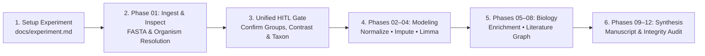

# TidyProteomics Agent

<p align="center">
  <strong>Autonomous Quantitative Proteomics Studio &bull; Multi-Model Agentic Orchestrator &bull; Embedded Literature Knowledge Graph</strong>
</p>

<p align="center">
  
  
  
  
  
  
  
  
  
</p>

---

## Overview

**TidyProteomics Agent** is a full-stack, standalone scientific workbench and autonomous AI orchestrator for high-throughput quantitative mass spectrometry proteomics. It unites the statistical power of R’s [`tidyproteomics`](https://github.com/jeffsocal/tidyproteomics) package with autonomous LLM agents, deterministic data integrity verifiers, an embedded biomedical literature knowledge graph, and a Human-in-the-Loop (HITL) study design studio.

From raw instrument search tables (MaxQuant, ProteomeDiscoverer, DIA-NN, Spectronaut) or external differential expression matrices, TidyProteomics Agent autonomously performs quality control, contaminant filtering, multi-method normalization benchmarking, condition-specific imputation, linear modeling, functional ontology enrichment, literature-grounded synthesis, and manuscript drafting—all while persisting reproducible R code scripts for every single step.

```
                     ┌───────────────────────────────────────────────────┐
                     │          Interactive 3-Pane Studio                │
                     │  (Workspace Tree • Forms • Live Chat & Telemetry) │
                     └──────────────────────┬────────────────────────────┘
                                            │ HTTP / WebSocket
                                            ▼
                     ┌───────────────────────────────────────────────┐
                     │     Node.js / TypeScript Orchestrator         │
                     │  - Multi-Model Router (Utility/Runner/Reason) │
                     │  - Unified HITL Study Design Gating Engine    │
                     │  - Rubric v2.0 Evaluation & Benchmark Engine  │
                     └───────┬───────────────────────────────┬───────┘
                             │                               │
        MCP (JSON-RPC)       │                               │ DuckDB SQL / Embeddings
                             ▼                               ▼
    ┌───────────────────────────────────┐    ┌───────────────────────────────────┐
    │  Python MCP Server + R Daemon     │    │   Embedded Literature Graph       │
    │  - Persistent tidyproteomics R env│    │   - 10k+ PubMed / PMC Assertions  │
    │  - Normalization Benchmarking     │    │   - Target & Phenotype Retrieval  │
    │  - Imputation (RandomForest/Min)  │    │   - Mechanistic Grounding         │
    │  - Differential Expression (limma)│    │   - Local Corpus Assertion Search │
    │  - Pathway Enrichment & Plots     │    └───────────────────────────────────┘
    └───────────────────────────────────┘
```

---

## Core Pillars & Capabilities

### 1. Resilient Human-in-the-Loop (HITL) Study Design Gates
Proteomics pipelines often fail silently due to misidentified sample cohorts, inverted statistical contrasts, improper imputation of knockouts, or confounded experimental batches. TidyProteomics Agent features a pre-flight **Unified Study Design Gate** centered on `docs/experiment.md`:

- **3.A Discovered Sample Groups**: Verifies detected biological cohorts and replicate groupings against raw file manifests.
- **3.B Quantitative Normalization Strategy**: Benchmarks linear models (`scaled`, `median`, `linear`, `limma`) and non-linear models (`loess`, `svm`, `randomforest`), evaluating replicate coefficient of variation (CV) distributions and sub-population invariant filters (`subset_filter`).
- **3.C Missing Value Imputation Strategy**: Strictly separates Missing at Random (MAR default: within-cohort `randomforest_grouped`) from Missing Not at Random (MNAR: Limit of Detection `min_column` for intentional CRISPR/siRNA knockouts and suppressions).
- **3.D Sample Group Renaming & Pooling Map**: Maps technical batch prefixes/suffixes and replicate runs into clean biological cohorts before modeling.
- **3.E Target Contrasts**: Enforces directional `<treatment>/<control>` pairwise contrasts so $\log_2\text{FC} > 0$ strictly represents induction.
- **3.F Batch Confounding Gate**: Automatically detects condition-batch confounding across processing runs and requests explicit researcher authorization before fitting linear models.
- **3.G Functional Annotation Strategy**: Selects UniProt KB autonomous remote fetching, local custom annotation tables, or bypass. **Smart gating ensures this checkpoint only halts after the target organism has been identified.**

### 2. Multi-Tier Autonomous Pipeline Execution
The orchestrator ships with specialized, production-ready pipelines:

| Pipeline | Target Scope | Key Milestones |
|---|---|---|
| **Differential Expression** (`12 Phases`) | Full discovery proteomics | Ingest &rarr; Normalize &rarr; Impute &rarr; DE (`limma`) &rarr; Enrichment &rarr; Observations &rarr; Literature Graph &rarr; Functional Synthesis &rarr; Manuscript &rarr; Publication Integrity |
| **Rapid Expression** (`6 Phases`) | Accelerated biomarker screens | Rapid QC &rarr; Benchmarking &rarr; Fast Imputation &rarr; DE &rarr; Enrichment &rarr; Executive Summary |
| **Peptide Analysis** (`8 Phases`) | Bottom-up peptide-level assays | Peptide Ingestion &rarr; Charge State & Missed Cleavage QC &rarr; Peptide Normalization &rarr; PTM & Feature Summaries |
| **Biological Synthesis** (`5 Phases`) | External pre-computed matrices | Ingest DE CSV/TSV &rarr; Fetch UniProt GO/Reactome &rarr; Multi-Ontology Enrichment &rarr; Literature Retrieval &rarr; Manuscript |
| **Quality Control Only** (`3 Phases`) | Instrument & run benchmarking | Ingestion Audit &rarr; Variation & CV Diagnostics &rarr; PCA & Hierarchical Clustering |

### 3. Embedded Literature Knowledge Graph & Ingestion Runner
- **Local DuckDB Assertion Database**: Stores structured molecular assertions (`studies`, `experimental_contexts`, `molecular_assertions`) extracted from biomedical literature.
- **Automated Literature Ingestion Engine**: Ingests PDFs, PubMed XMLs, and PMC articles into normalized entity assertions with context metadata (organism, model, perturbation, assay modality).
- **Corpus Assertion Search**: Real-time fuzzy query interface for candidate genes, functional modules, and aliases with evidence quote citations.
- **Fast Bypass Controls**: One-click local toggle to bypass literature queries for novel or non-model organism datasets.

### 4. Interactive 3-Pane Workbench (`20% / 60% / 20%`)
- **Left Pane — Project Explorer & Navigation**:
  - Top 2x2 drawer for instant tab opening: `[Settings]`, `[Library]`, `[Evaluation]`, and `[Guides]`.
  - Hierarchical workspace file tree writing directly to host disk (`docs/`, `data/`, `code/`, `logs/`, `analysis/`).
- **Center Pane — Tabbed Workspace Viewer**:
  - **`docs/experiment.md` Form Editor**: Interactive visual form with live validation badges, split-pane Markdown editor, and raw Markdown editor.
  - **Pipeline Progress Telemetry Table**: Real-time phase tracking with elapsed durations, agent turns, token usage (prompt, cached, completion), and expandable execution logs.
  - **Rich File Previews**: High-resolution PNG/SVG plot viewers, interactive Plotly charts, paginated tabular CSV/TSV inspectors, and syntax-highlighted R scripts.
  - **In-App Guides & Manuals**: Integrated searchable readers for the [Quick "How-To" Guide & Studio Tour](reference/howto.md), [Operations Guide](reference/operations.md), and [Scientific Guide to Normalization & Imputation](reference/scientific.md) with PDF export.
- **Right Pane — Agentic Chat & Telemetry**:
  - Live agent streaming with turn counters, scientific reasoning, tool calls, and structured findings.
  - Quick-action suggestion chips (`Confirm All & Proceed`, `Fetch UniProt`, `Explain Observations`).
  - Interactive 12-segment progress bar with direct click-to-focus navigation.

### 5. AI Benchmark Suite & Evaluation Rubric v2.0
TidyProteomics Agent includes an automated benchmarking engine to rigorously evaluate LLM performance on proteomics analysis:
- **Deterministic Data Verifiers**: Pure algorithmic checks testing numeric fidelity (reported $\log_2\text{FC}$ and $p$-values matching data tables), regulation sign consistency, count accuracy, and figure traceability.
- **3-Model Frontier Reviewer Panel**: Evaluates manuscripts across 25 anchored criteria with quote citations using independent frontier models (Anthropic Claude 3.7 Sonnet, OpenAI GPT-4o, Google Gemini 2.0/3.8).
- **Multi-Model Tier Routing**: Assign distinct models per operational tier (Utility, Tool Runner, Reasoner) or per pipeline phase to optimize cost and analytical depth.

---

## Workspace Directory Architecture

When initializing a workspace, TidyProteomics Agent establishes a standardized directory layout:

```
workspace/
├── docs/                      # Working deliverables and human-readable study specs
│   ├── experiment.md          # Master study parameters & Section 3 HITL gates
│   ├── notes.md               # Continuous blackboard of phase completions
│   ├── manuscript.md           # Publication-ready scientific manuscript
│   └── report_*.md            # Individual phase deep-dive reports
├── data/                      # Quantified outputs, tables, and generated figures
│   ├── tidyproteomics_data.rds# Master active tidyproteomics R state object
│   ├── plot_proteins_*.png    # Diagnostic figures (counts, CV variation, PCA, volcano)
│   ├── table_proteins_*.tsv   # Differential expression & pathway enrichment tables
│   └── annotations_uniprot.tsv# Cached biological ontology terms (GO, Reactome, KEGG)
├── code/                      # Fully reproducible, standalone R scripts
│   ├── 01_inspect.R           # Data ingestion & accounting script
│   ├── 02_normalize.R         # Contaminant filtering & normalization script
│   ├── 03_impute.R            # Condition-aware imputation script
│   ├── 04_differential_expression.R # Linear modeling (limma) script
│   └── 05_enrichment.R        # Pathway enrichment & batch analysis script
├── logs/                      # Comprehensive telemetry & console logs
│   ├── pipeline.md            # Master chronological pipeline execution log
│   └── [phase_slug]/          # Per-phase console.log and LLM turn transcripts
├── analysis/                  # Pipeline instruction templates for active run
└── literature/                # DuckDB literature graph & ingested PDF context files
```

---

## Quick Start

### Prerequisites

| Component | Minimum Version | Notes |
|---|---|---|
| **Node.js** | `>= 18.0.0` | Primary orchestrator & web server |
| **Python** | `>= 3.10` | MCP Server execution (`mcp/server.py`) |
| **R** | `>= 4.3.0` | Requires `tidyproteomics`, `readr`, `glue`, `jsonlite` |
| **Docker** | *(Optional)* | For instant, zero-dependency all-in-one container deployment |

---

### Option A: Local Host Development

1. **Clone the repository**:
   ```bash
   git clone https://github.com/jeffsocal/tidyproteomics-agent.git
   cd tidyproteomics-agent
   ```

2. **Install Node.js dependencies**:
   ```bash
   npm install
   ```

3. **Install Python & R prerequisites**:
   ```bash
   pip install mcp flask requests
   Rscript -e "install.packages(c('readr', 'glue', 'jsonlite', 'tibble', 'dplyr', 'ggplot2'), repos='https://cloud.r-project.org')"
   Rscript -e "remotes::install_github('jeffsocal/tidyproteomics')"
   ```

4. **Build the web application and server**:
   ```bash
   npm run build
   ```

5. **Start the studio**:
   ```bash
   npm start
   ```
   Open **`http://localhost:3000`** in your browser.

> **Development Mode**: For hot-reloading web frontend and server processes:
> ```bash
> npm run dev:web     # Vite dev server on port 5173
> npm run dev:server  # TSX server watcher
> ```

---

### Option B: Self-Contained Docker Container (Fastest & Zero-Dependency)

Run the entire studio (Web UI, Node.js Orchestrator, Python MCP Server, R Daemon, and TidyProteomics) with a single command. **No manual directory creation or environment file editing is required**—all configuration is handled directly in the browser:

1. **Start the studio**:
   ```bash
   docker compose up --build
   ```
   *(Add `-d` if you want to run it in the background).*

2. **Open the Studio**:
   Navigate to **`http://localhost:3000`** in your browser.

3. **Configure directly in the Web UI**:
   - **API Key**: In the **Settings** tab, select your preferred provider (Anthropic, OpenRouter, OpenAI, Gemini, or local Ollama) and paste your API key. Settings are saved automatically to a persistent Docker volume (`tidyproteomics-config`) across container restarts and updates.
   - **Workspace**: Select or initialize your project workspace directly in the UI. Any data files, R code, plots, and manuscripts are automatically persisted to `./workspaces/` on your host machine.

> **Optional Headless / Server Deployment**: If deploying to a headless cloud server or CI/CD environment, you can optionally pass API keys via host environment variables or a `.env` file (`ANTHROPIC_API_KEY`, `OPENAI_API_KEY`, `GEMINI_API_KEY`, `OPENROUTER_API_KEY`), but this is completely optional for normal interactive use.

---

## Configuring LLM Providers & API Keys

Navigate to the **Settings** tab (or click `[Settings]` in the top-left drawer) to configure your AI provider:

| Provider | Supported Models | Description |
|---|---|---|
| **OpenRouter** *(Recommended)* | `anthropic/claude-3.7-sonnet`, `openai/gpt-4o`, `google/gemini-2.0-flash-001`, `deepseek/deepseek-r1` | Single API key for hybrid frontier reasoning & ultra-low cost runs |
| **Anthropic** | `claude-3-7-sonnet-latest`, `claude-3-5-sonnet-latest`, `claude-3-5-haiku` | Premier analytical depth & complex biological reasoning |
| **OpenAI** | `gpt-4o`, `gpt-4o-mini`, `o3-mini`, `o1` | High quantitative consistency & structured outputs |
| **Google Gemini** | `gemini-2.0-flash`, `gemini-2.0-pro-exp`, `gemini-1.5-pro` | Fast tool execution & large-context document grounding |
| **Local / Ollama** | `llama3.3`, `qwen2.5-coder`, `deepseek-r1:32b` | Completely private, offline local inference via Ollama |

---

## Running an Analysis: Step-by-Step Workflow



1. **Initialize Workspace**: Open the `Settings` tab, pick or create a project directory, and click **Initialize Workspace Template** (`differential_expression`).
2. **Define Experiment Parameters**: Open the `Experiment Setup` tab, provide the path to your data file (e.g. `data/raw/data.tsv`), instrument platform (`MaxQuant`, `ProteomeDiscoverer`, `DIA-NN`, etc.), analyte (`proteins`), and biological hypothesis.
3. **Start the Pipeline**: Click **`Run / Resume Pipeline`** in the top navigation or Pipeline Progress tab.
4. **Phase 1 (Inspection & Organism Identification)**: The agent loads the dataset, audits identifiers, checks missingness, and detects the target organism from FASTA headers or protein accessions.
5. **Human-in-the-Loop Review**: At the Phase 2 Study Design Gate, review discovered sample groups, suggested contrasts, normalization benchmarks, and the identified functional annotation strategy. Confirm with one click (`Confirm All Study Design & Proceed`).
6. **Autonomous Downstream Execution**: The pipeline autonomously benchmarks normalization, applies condition-aware imputation, fits linear models, queries the literature graph, compiles publication figures, and drafts `docs/manuscript.md`.

---

## Benchmark & Rubric Evaluation

Run comprehensive multi-model evaluations directly from the CLI or via the in-app **AI Evaluation** tab:

```bash
# Execute benchmark rubric evaluation across completed runs
npm run test:rubric

# Algorithmic data integrity & figure audit
npm run verify:integrity

# Re-score existing runs using LLM reviewer panel
npm run rescore:llm
```

---

## Contributing & Development

Contributions, bug reports, and suggestions are welcome!

```bash
# Run web client typecheck & build
npm run build:web

# Run server typecheck & build
npm run build:server

# Run combined build
npm run build
```

---

## Scientific Publications & Citations

If you use TidyProteomics Agent in your research, please cite:

- **TidyProteomics R Package**:
  > *Jeffsocal et al.*, tidyproteomics: An open-source R package for quantitative proteomics analysis. [GitHub Repository](https://github.com/jeffsocal/tidyproteomics).
- **Statistical Normalization & Missing Data Methodologies**:
  - Karpievitch, Y. V., et al. (2012). *Normalization and missing value imputation for label-free LC-MS analysis.* **BMC Bioinformatics**, 13(S16), S5.
  - Välikangas, T., et al. (2018). *A systematic evaluation of normalization methods in quantitative label-free proteomics.* **Briefings in Bioinformatics**, 19(1), 1–11.
  - Ritchie, M. E., et al. (2015). *limma powers differential expression analyses for RNA-sequencing and microarray studies.* **Nucleic Acids Research**, 43(7), e47.

---

## License

This project is open-source under the [MIT License](LICENSE).

## Development Note

TidyProteomics-Agent was architected and validated by Jeffrey Jones, with heavy coding and software engineering assistance from Google Gemini.
